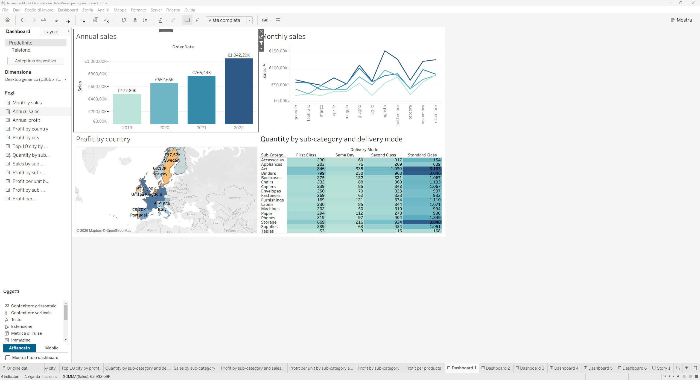
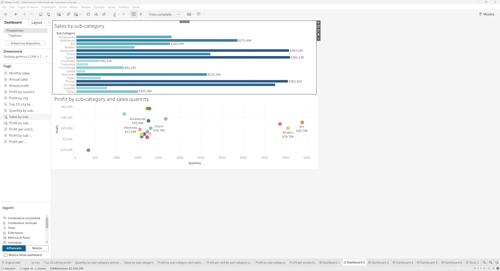
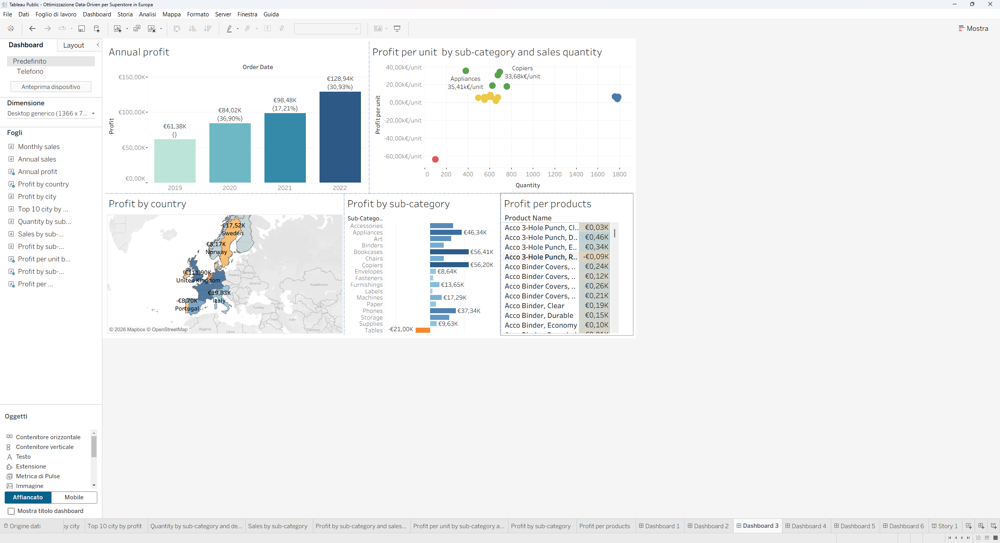
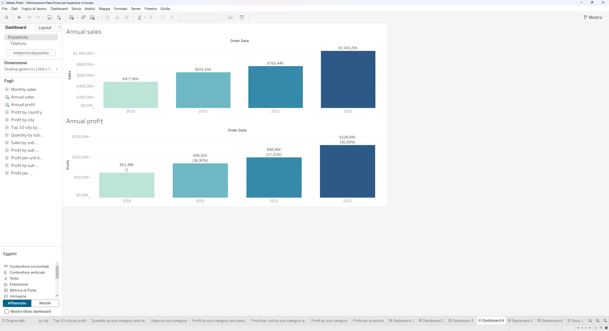
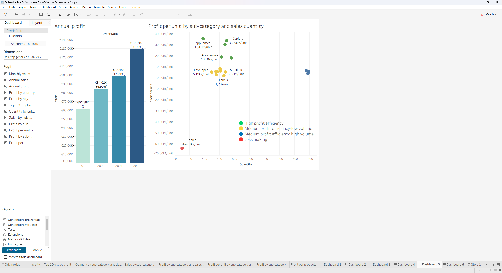
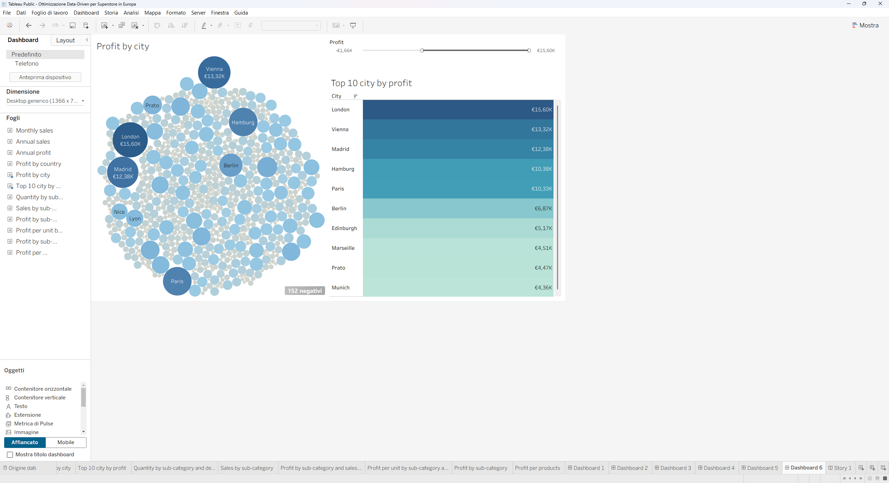
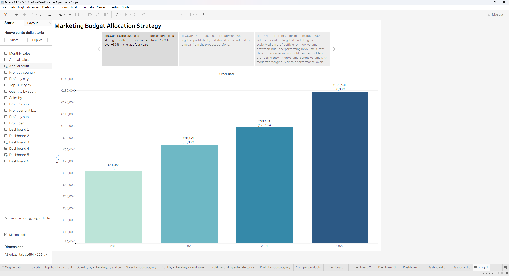
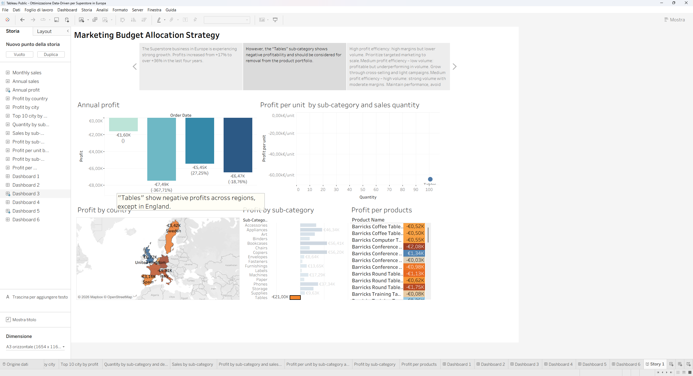
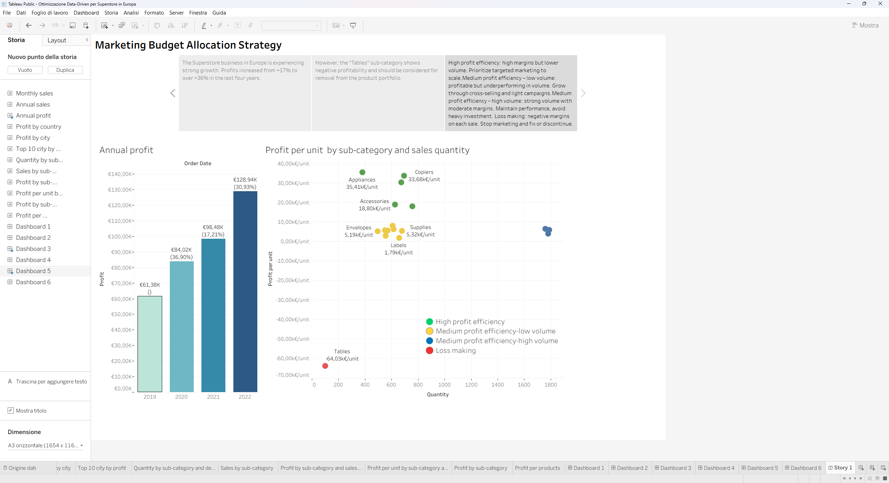

# 📊 Data-Driven Optimisation for Superstore in Europe
## 📌 Project Overview
This project focuses on analyzing Superstore's business performance across European markets using Tableau, with the aim of monitoring sales trends, evaluating product profitability, and supporting data-driven strategic decisions.

The project involves the development of six interactive Tableau dashboards and a Tableau Story designed to provide business insights into sales performance, geographical profitability, product efficiency, and marketing budget allocation.

The dashboards allow users to explore business performance through dynamic visualizations and interactive filters, while the Tableau Story follows a structured analytical narrative to identify products with growth potential, underperforming categories, and opportunities for marketing investment optimization.

The project combines data visualization, profitability analysis, geographical analysis, and product segmentation techniques to transform transactional data into actionable business insights.

## 🗂️ Dataset
**Source:** Excel dataset provided for the Superstore business case.

**Dataset:** Global Superstore

**Geographical Scope:** European markets, including the United Kingdom.

**Time Period:** 2019–2022.

**Main Variables:** Sales, Profit, Quantity, Product, Sub-Category, Country, State, City, and Delivery Mode.

## 🎯 Business Objectives
The main objectives of the project were:

- Monitor sales performance and identify annual and monthly trends.
- Analyze profit distribution across European countries, states, and cities.
- Evaluate product and sub-category sales performance.
- Investigate the relationship between product quantities sold and profitability.
- Compare annual sales and profit growth rates.
- Analyze product profitability and identify underperforming categories.
- Segment products according to profit efficiency using clustering techniques.
- Identify products with high growth potential and opportunities for targeted marketing investments.
- Support strategic decisions regarding marketing budget allocation and product portfolio optimization.

## 🛠️ Tools & Techniques
- Tableau Desktop
- Data Visualization
- Interactive Dashboards
- Tableau Stories
- Interactive Filters
- Geographic Data Visualization
- Sales Performance Analysis
- Profitability Analysis
- Year-over-Year (YoY) Growth Analysis
- Product Performance Analysis
- Shipping and Delivery Analysis
- Scatter Plot Analysis
- Product Segmentation and Clustering
- Profit Efficiency Analysis
- Marketing Budget Allocation
- Data-Driven Decision-Making

## 📂 Project Structure
The Tableau project consists of six interactive dashboards and one Tableau Story, supported by individual worksheets containing the visualizations used to build the dashboards.

The dashboards provide an overview of Superstore's business performance across European markets, while the Tableau Story focuses on product profitability and strategic marketing budget allocation.

## 1. Tableau Dashboards
### Dashboard 1 – Business Performance Overview

This dashboard provides an overview of Superstore's overall business performance through sales trends, geographical profitability, and product delivery analysis.

Key analytical activities:

 - **Annual Sales Analysis:** Visualization of total sales by year using a bar chart.
 - **Monthly Sales Analysis:** Monitoring of monthly sales trends using a line chart.
 - **Profit by Country:** Geographical visualization of profit distribution across European countries using a map.
 - **Quantity by Sub-Category and Delivery Mode:** Analysis of product quantities across sub-categories and delivery modes using a color-coded table.

## Dashboard 2 – Sales and Profitability by Sub-Category
This dashboard focuses on evaluating sales volumes and profitability across product sub-categories.

Key analytical activities:

- **Sales by Sub-Category:** Comparison of total sales across product sub-categories using a horizontal bar chart.
- **Profit vs. Quantity Analysis:** Scatter plot exploring the relationship between profit and quantities sold across sub-categories.

## Dashboard 3 – Profitability Analysis
This dashboard provides a detailed analysis of profit performance across years, geographical areas, product sub-categories, and individual products.

Key analytical activities:

- **Annual Profit:** Comparison of total profit across the four years using a column chart.
- **Profit per Unit vs. Quantity Analysis:** Scatter plot examining the relationship between profit per unit and quantities sold across product sub-categories.
- **Profit by State:** Geographical visualization of profit distribution across European states.
- **Profit by Sub-Category:** Comparison of profitability across product sub-categories using a horizontal bar chart.
- **Profit by Product:** Tabular analysis of profit generated by individual products.
- **Profit Growth Rates:** Display of year-over-year profit growth percentages directly within the annual profit visualization.

## Dashboard 4 – Sales and Profit Growth Analysis
This dashboard focuses on monitoring the evolution of sales and profitability over the 2019–2022 period.

Key analytical activities:

- **Annual Sales Performance:** Comparison of total sales across the four years using a column chart.
- **Annual Profit Performance:** Comparison of total profit across the four years using a column chart.
- **Profit Growth Rates:** Display of year-over-year profit growth percentages directly within the annual profit visualization.

The dashboard provides an overview of the company's financial performance, allowing users to compare annual sales and profit trends while monitoring changes in profitability over time.

## Dashboard 5 – Profit Efficiency and Product Segmentation
This dashboard focuses on evaluating product sub-categories according to their profit efficiency and sales volumes.

Key analytical activities:

- **Annual Profit and Growth:** Visualization of annual profit and corresponding growth percentages.
- **Profit per Unit vs. Quantity Analysis:** Scatter plot comparing profit per unit across product sub-categories with the corresponding quantities sold.
- **Product Clustering:** Application of clustering techniques to segment sub-categories according to their profit efficiency.
- **Profit Growth Rates:** Display of year-over-year profit growth percentages directly within the annual profit visualization.

The clustering analysis helps identify different product performance groups, highlighting opportunities for targeted marketing investments and profitability improvement.

## Dashboard 6 – Geographical Profitability Analysis
This dashboard explores profit distribution across European cities and identifies the locations generating the highest financial returns.

Key analytical activities:

- **Profit by City:** Bubble chart representing profit generated by individual cities.
- **Interactive Profit Selection:** Interactive reference line allowing users to explore city profitability according to a selected profit threshold.
- **Top 10 Cities by Profit:** Ranking of the ten most profitable cities.
  
This analysis supports geographical performance comparison and helps identify high-performing markets for potential business expansion.

## 2. Tableau Story
The Tableau Story presents a structured business analysis aimed at evaluating Superstore's financial performance, identifying product profitability issues, and defining strategic marketing recommendations based on product segmentation.

The Story consists of three sequential Story Points, guiding the analysis from overall business growth to product-level profitability and targeted marketing strategies.

## Story Point 1 – Business Growth Overview
This opening section highlights the evolution of Superstore's profitability across the 2019–2022 period.

Key analytical activities:

- **Annual Profit and Growth Analysis:** Column chart displaying annual profit and corresponding year-over-year growth percentages.
  
The analysis highlights strong business growth across the four-year period, with profit growth increasing from approximately +17% to over +36%.

**Key Insight:** Superstore's business in Europe is experiencing strong growth, with profitability showing a positive trend over the analyzed period.

## Story Point 2 – Product Profitability Analysis
This section investigates the company's profitability across geographical areas, product sub-categories, and individual products to identify potential weaknesses in the product portfolio.

Key analytical activities:

- **Annual Profit:** Column chart displaying total profit across the four years.
- **Profit per Unit vs. Quantity Analysis:** Scatter plot examining the relationship between profit per unit and quantities sold across product sub-categories.
- **Geographical Profitability:** Map visualizing profit distribution across European states.
- **Profit by Sub-Category:** Horizontal bar chart comparing profitability across product sub-categories.
- **Profit by Product:** Table displaying profit generated by individual products.
  
**Key Insight:** The Tables sub-category shows negative profitability, indicating that it should be considered for potential removal from the product portfolio or further investigation to identify the causes of its poor performance.

## Story Point 3 – Product Segmentation and Marketing Strategy
The final section focuses on product segmentation using Tableau clustering techniques, combining profit per unit and quantity sold to classify product sub-categories according to their profitability and sales performance.

Key analytical activities:

- **Annual Profit:** Column chart providing an overview of profit evolution across the analyzed years.
- **Profit Efficiency and Product Clustering:** Scatter plot displaying product sub-categories segmented into clusters according to profit per unit and quantities sold.

The clustering analysis identifies four distinct product performance groups, each associated with a different strategic marketing approach:

- **High Profit Efficiency:** Products with high profit margins but lower sales volumes. Prioritize targeted marketing campaigns to increase sales volume and leverage its profitability.
- **Medium Profit Efficiency – Low Volume:** Profitable products with relatively low sales volumes. Focus on cross-selling opportunities and targeted promotional campaigns to stimulate demand.
- **Medium Profit Efficiency – High Volume:** Products generating strong sales volumes with moderate profit margins. Maintain current results without spending too much on marketing.
- **Loss-Making Products:** Products that generate negative margins on every sale. Stop marketing investments and evaluate opportunities to improve profitability, or consider discontinuing the product.

**Key Insight:** Product segmentation provides a strategic framework for optimizing marketing budget allocation, prioritizing high-potential products, maintaining efficient product categories, and addressing loss-making sub-categories.

## 💡 Business Value
The Tableau dashboards and Story provide a comprehensive overview of Superstore's business performance across European markets, supporting data-driven decisions through sales monitoring, profitability analysis, and product segmentation.

The main business benefits include:

- **Business Performance Monitoring:** Analyzing annual and monthly sales and profit trends helps monitor business growth and evaluate overall financial performance.
- **Geographical Profitability Analysis:** Visualizing profit distribution across European countries, states, and cities helps identify the most profitable markets and geographical areas requiring further attention.
- **Product Portfolio Optimization:** Comparing sales and profitability across product sub-categories and individual products helps identify high-performing categories and underperforming products, including loss-making segments.
- **Profitability and Sales Efficiency:** Analyzing the relationship between profit per unit and quantities sold provides insights into product performance, highlighting differences between sales volume and profit efficiency.
- **Product Segmentation and Clustering:** Applying clustering techniques allows products to be grouped according to their profitability and sales volumes, supporting the identification of different performance profiles.
- **Marketing Budget Optimization:** Using product segmentation results to define targeted marketing strategies helps prioritize investments in high-potential products, stimulate sales of profitable but underperforming categories, and avoid unnecessary spending on loss-making products.
- **Data-Driven Strategic Decisions:** The combination of interactive dashboards and Tableau Story transforms transactional data into actionable business insights, supporting decisions related to profitability improvement, product portfolio management, and marketing resource allocation.

## 🎓 Conclusion
This project demonstrates how Tableau can be used to transform transactional business data into interactive visualizations and actionable business insights.

By developing six interactive dashboards and a three-point Tableau Story, the project provides a comprehensive analysis of Superstore's performance across European markets, covering sales trends, geographical profitability, product performance, and profit efficiency.

The application of clustering techniques further extends the analysis by segmenting product sub-categories according to their profitability and sales volumes, providing a basis for targeted marketing strategies and more efficient budget allocation.

Overall, this project has strengthened my practical skills in Tableau, data visualization, business performance analysis, geographical analysis, profitability assessment, product segmentation, clustering techniques, and data-driven strategic decision-making.

## 📁 Repository Contents
- **[Ottimizzazione_Data_Driven_per_Superstore_in_Europa.twbx](Ottimizzazione_Data_Driven_per_Superstore_in_Europa.twbx):** Packaged Tableau workbook containing the six interactive dashboards, the Tableau Story, visualizations, and the integrated Excel dataset.
- **[DATA](DATA):** Folder containing the original Excel dataset used for the analysis.
- **[images](images):** Folder containing screenshots of the six Tableau dashboards and the Tableau Story.

## 🌐 Interactive Dashboard
Explore the interactive Tableau dashboards and Story online:

# 📊 [View the Interactive Tableau Project on Tableau Public](https://public.tableau.com/app/profile/silvia.venturini/viz/OttimizzazioneData-DrivenperSuperstoreinEuropa_17745647859630/Story1)

The project is also available as a downloadable Tableau Packaged Workbook (.twbx) in this repository.

## 📸 Project Preview
## 1. Tableau Dashboards

**Dashboard 1 – Business Performance Overview**

Overview of Superstore's business performance, including annual and monthly sales trends, geographical profitability, and product delivery analysis.

**Dashboard 2 – Sales and Profitability by Sub-Category**

Comparison of sales volumes and profitability across product sub-categories, including the relationship between profit and quantities sold.

**Dashboard 3 – Profitability Analysis**

Detailed analysis of profit distribution across years, geographical areas, product sub-categories, and individual products.

**Dashboard 4 – Sales and Profit Growth Analysis**

Monitoring of annual sales and profit performance, including year-over-year profit growth rates.

**Dashboard 5 – Profit Efficiency and Product Segmentation**

Analysis of product profitability and sales volumes, including clustering techniques to identify different product performance groups.

**Dashboard 6 – Geographical Profitability Analysis**

Geographical analysis of profit distribution across European cities, highlighting the most profitable locations.

## 2. Tableau Story
The Tableau Story presents a structured analytical narrative, moving from overall business growth to product profitability analysis and strategic marketing recommendations.

**Story Point 1 – Business Growth Overview**

Analysis of annual profit performance and year-over-year growth across the 2019–2022 period.

**Story Point 2 – Product Profitability Analysis**

Investigation of product and geographical profitability, highlighting underperforming sub-categories and potential portfolio optimization opportunities.

**Story Point 3 – Product Segmentation and Marketing Strategy**

Clustering-based product segmentation according to profit efficiency and sales volumes, supporting targeted marketing strategies and budget allocation.

## 📬 Contact
- **Silvia Venturini**
- [LinkedIn](https://www.linkedin.com/in/silvia-venturini92/)
- **Email:** silvia.venturini92@hotmail.com
